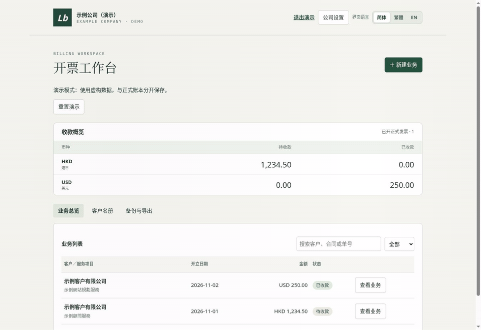

# Local Billing Workspace｜本地开票工作台

一个从实际开票需求中整理出来的轻量工具。将客户、形式发票、正式发票和收据放在同一笔业务下管理，支持港币和美元、PDF 导出、本地备份和客户资料识别。

作者：**Josie Xiang** · 产品经理 · 使用 AI 辅助开发

[创作者心得](docs/creator-notes.md) · [产品案例](docs/case-study.md) · [搭建与配置](docs/setup.md) · [验证结果](docs/validation.md)

## 一分钟了解

下面的 60 秒分步演示由实际操作截图组成，全部使用虚构数据。



[查看演示步骤](docs/demo.md) · [下载 MP4](docs/images/walkthrough.mp4)

## 为什么做

开票会同时涉及客户资料、合同编号、付款通知、到账日期和收款凭证。分别维护这些文件时，容易重复输入、混淆编号，或在换设备时漏掉记录。

这个项目把操作入口收敛到一笔业务：创建客户与服务项目，开付款通知，确认全额到账，然后查看和导出相关单据。适合独立服务提供者及小型服务业务的单人使用场景。

## 已有功能

| 功能 | 当前行为 |
| --- | --- |
| 业务管理 | 待收款、已收款、已取消状态；按客户、服务或编号查找 |
| 三类单据 | 形式发票 PI；确认全额到账后生成正式发票 INV 和收据 RC |
| 币种 | HKD / USD 分别汇总，不混合相加 |
| 语言 | 简体、繁体、英文界面；繁体双语或英文单据 |
| 客户识别 | PDF / JPG / PNG / WebP，本地文字提取与 OCR，保存前人工核对 |
| 导出 | 单张 PDF、发票与收据 ZIP、交易 CSV |
| 备份 | 账本与公司设置一起备份；选择性恢复设置；重复跳过、冲突阻止写入 |
| 公司设置 | 在浏览器填写公司抬头、收款资料、签署人、时区及合同前缀 |
| 离线版本 | 自包含 HTML；不需要账号或后台数据库 |

## 快速开始

安装 Python 3，在项目根目录运行：

```bash
python3 -m http.server 8000 --bind 127.0.0.1 --directory dist
```

打开 <http://127.0.0.1:8000>。

1. 点击右上角“公司设置”。默认资料全部为演示占位内容。
2. 点击“体验演示”即可载入独立的虚构账本；正式使用时，在“客户名册”添加自己的客户。
3. 创建业务、选择币种并填写金额，生成形式发票。
4. 实际到账后确认收款，生成正式发票与收据。
5. 在“备份与导出”下载完整备份。

程序默认从**空账本**开始。仓库中的公司和客户示例均为虚构；请勿把自己的账本、银行资料或客户证件提交到仓库。

## 下载离线版

打开 `dist/Billing-Workspace.html` 即可使用自包含版本。修改源码后重新生成：

```bash
python3 scripts/build-offline.py
```

源码版通过本机 HTTP 启动时，浏览器功能与文件加载行为通常更稳定。离线文件的 OCR、下载和翻译支持仍取决于浏览器；首次使用应以虚构数据确认。

## 演示模式

点击右上角“体验演示”，或在本机网址后加上 `?demo=1`。演示使用独立存储键，提供待收款和已收款示例，可重置。退出演示后回到原账本。

## 别人如何复用

可以下载 ZIP、克隆仓库，或在仓库开启 Template 后点击 **Use this template** 创建自己的项目。按上面的步骤运行，再在“公司设置”填入自己的资料。

真实公司设置保存在当前浏览器，不会写回源码；`dist/config.js` 只放公开的演示默认值。需要修改业务逻辑的开发者，可从下列文件开始：

| 文件 | 职责 |
| --- | --- |
| `dist/app.js` | 业务状态、编号、导入校验、单据模板与交互 |
| `dist/config.js` | 演示默认配置、公司设置校验与本地读取 |
| `dist/backup.js` | 版本化备份、旧格式兼容及公司设置恢复计划 |
| `dist/demo-data.js` | 演示模式专用虚构数据 |
| `dist/lang.js` | 界面文字与语言偏好 |
| `dist/customer-pdf.js` | PDF 文本提取、图片 OCR、客户字段提取 |
| `dist/customer-tools.js` | PDF 和 ZIP 生成、客户辅助操作 |
| `dist/vendor/`、`dist/pdf-assets/` | 本地依赖、OCR 模型、字体与授权文件 |
| `scripts/build-offline.py` | 将静态资源打包为单文件版本 |
| `tests/core.cjs` | 编号、备份冲突、配置及模板的回归检查 |

## 数据保存与使用边界

- 客户和交易保存在当前站点、当前浏览器的 `localStorage`。源码版和离线版、不同网址、设备及浏览器之间不会自动同步。
- 完整备份包含账本和公司设置。导入时默认保留当前公司设置，勾选后才恢复备份中的设置；旧版账本备份继续兼容。
- 当前是单人本地工具，没有团队权限、跨设备同步、银行自动对账或服务端审计日志。本地记录也没有额外加密。
- 收款流程以全额到账为前提；部分收款、分期、税项、汇率换算及多行商品尚未实现。
- 浏览器翻译能力可用时才生成自定义英文；识别与翻译结果都需要核对。
- PI 错单在取消后可以删除并释放序号；已生成 INV / RC 的业务保留原编号。详细规则见[业务说明](docs/product-decisions.md)。

## 验证

需要 Node.js 18 或以上：

```bash
node tests/core.cjs
```

目前有32项回归检查；浏览器已验证单张及成对 PDF、收款、公司设置迁移和本地 OCR 的虚构样例。[验证结果](docs/validation.md)列出环境和未覆盖范围。GitHub Actions 使用只读权限运行检查。

## 开发方式与授权

我负责需求梳理、业务规则、使用反馈和产品迭代，代码实现与文档整理使用了 AI 辅助。项目仍在持续完善，欢迎通过 Issue 提交可复现的问题；请只附虚构数据。

项目自身代码采用 [MIT License](LICENSE)。第三方组件和字体保留各自授权，见 [THIRD_PARTY_NOTICES.md](THIRD_PARTY_NOTICES.md)。
