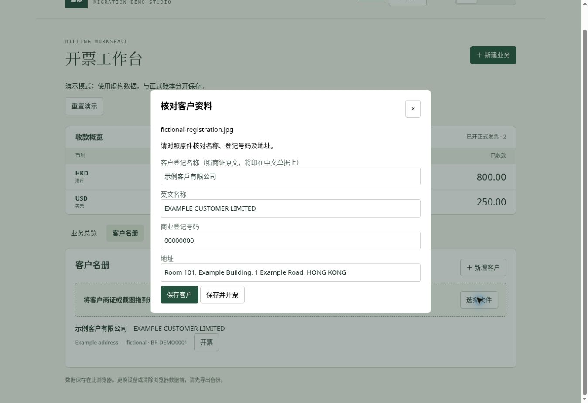

# 一分钟分步演示

[MP4 文件](images/walkthrough.mp4) · [GIF 动画](images/walkthrough.gif)

本演示由实际浏览器操作截图组成，每步展示约10秒；全部客户、公司与金额均为虚构，不代表真实交易。

| 时间 | 画面 | 展示的能力 |
| --- | --- | --- |
| 00–10 秒 | 业务总览 | HKD / USD 分开汇总，业务按状态展示 |
| 10–20 秒 | 创建业务 | 选择客户、服务、币种与金额，分配编号 |
| 20–30 秒 | 形式发票 | 双语单据和本地 PDF 导出 |
| 30–40 秒 | 收款后业务 | 正式发票和收据归入同一笔业务 |
| 40–50 秒 | 完整备份 | 公司设置与账本一起导出 |
| 50–60 秒 | 恢复确认 | 重复跳过、明确选择公司设置恢复 |

## 浏览器里自己体验

启动本机程序后，点击“体验演示”。演示账本与正式账本分开保存，提供“重置演示”按钮。

## 本地文字识别

验证使用明确标注为虚构的测试图片。该清晰样例的中英文名称、登记号码和地址均成功提取；真实拍照、模糊图像及不同证件版式仍需人工核对。
