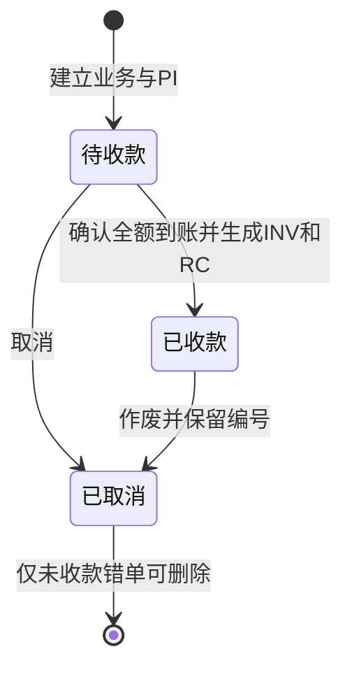

# 业务规则与当前边界

| 决策 | 当前实现 | 原因或限制 |
| --- | --- | --- |
| 业务作为操作入口 | 客户、服务、金额与单据关联 | 减少在多个编号间寻找入口 |
| 金额用最小货币单位存储 | 123450 表示 1234.50 | 避免直接用小数反复计算金额；仍需限制有效范围 |
| HKD 与 USD 分开汇总 | 每币种各列待收和已收 | 未实现汇率换算，不应直接相加 |
| 全额收款后开 INV / RC | 手动确认银行到账日期 | 没有银行接口；部分付款流程尚未实现 |
| 年度单据序号 | PI、INV、RC 分别编号 | 同一浏览器、同一网址的新版页面以 Web Locks 串行分配；跨设备无共享编号机制 |
| 取消与删除有区别 | 取消保留；未收款、未生成 INV / RC 的取消 PI 可删除 | 仅适合处理尚未发送的错单；删除会释放同年 PI 序号 |
| 已收款记录取消 | 保留 INV / RC，单据显示取消 | 不执行退款，也没有贷项通知单流程 |
| 合并导入 | 相同跳过，同号金额或状态冲突时拒绝 | 不自动裁决两份不同账本谁正确 |
| OCR 先核对再保存 | 名称、登记号码与地址待确认 | 版式与清晰度会影响识别 |
| 签发方快照 | PI 建立时保存公司资料，INV / RC 沿用该业务快照 | 修改设置只影响新业务；不提供历史签发方的静默覆盖 |
| 旧记录迁移 | 用记录原有公司设置建立 legacy-baseline，升级写入前保存原始字节 | 无法重建升级前已被覆盖的资料；页面显示限制 |
| 公司设置迁移 | 完整备份包含设置，导入时明确选择是否恢复 | 旧备份兼容；避免无意覆盖当前公司资料 |
| 演示隔离 | 演示使用独立本地存储键 | 体验和重置均限于虚构账本 |
| 同站点写入 | Web Locks 包围重新读取、分配编号和最终保存 | 不支持锁时停止写入；没有跨设备同步 |
| 本地保存 | localStorage，无后台 | 可独立运行，跨设备迁移需要手动备份 |

这是服务业务单人使用的轻量工具。当前不包含多行商品、税项、部分收款、团队权限及不可篡改审计日志。复用时应按自己的业务要求调整模板、编号和保留规则。

公开版本使用新的存储键，从空账本启动，避免与原有私人版本混用。演示公司配置和客户记录均为虚构。

## 核心状态

取消和退款分别处理；删除不会执行银行操作。导入恢复已有记录也不会自动确认到账。

## 公司资料更正与历史保留

新业务在建立 PI 时保存完整的 `issuer`：版本、来源和规范化公司设置。票面只读取这份快照。确认到账时沿用该业务的签发方，避免同一笔业务中途出现不同公司。修改公司设置后新建的业务使用新资料。

快照不提供直接编辑入口。若抬头或收款资料填错，应核对是否已经发送及收款，按现有取消规则保留原记录，再用正确设置建立新业务。已收款单据保留编号，实际退款或重新收款需另行处理。英文客户名和服务描述仍允许明确补填；本次保证的是公司资料稳定，并未冻结整个文档或建立不可篡改审计。

旧账本没有快照时，先使用账本中的公司设置；缺少时使用当前可取得的设置，标记为 `legacy-baseline`。首次写入升级结果前保留原始记录，备份页可下载。更早已经变化的历史无法自动还原。

v1 / v2 导入的新记录使用备份中的公司设置留底；备份没有公司设置时使用当前设置，确认页会提示。重复记录保留已有快照；同号且签发方不同的记录阻止合并。v3 备份必须包含快照，缺失或不完整时拒绝导入。

## 本地写入一致性

读取、编号分配、状态变化和最终保存都在同一存储键的 Web Lock 内执行。提交时重新读取账本，避免使用表单打开时的旧副本覆盖他人的新增记录。收款确认具有幂等性；公司设置表单发生并发修改时要求重新打开，不静默覆盖。

锁只覆盖同一来源、遵守本版协议的页面。升级前关闭旧版页面；没有服务器、跨设备锁或多人权限。不支持 Web Locks 的浏览器允许查看和导出，但停止写入。原始 JSON 可由使用者修改，本地快照不构成防篡改证明。
