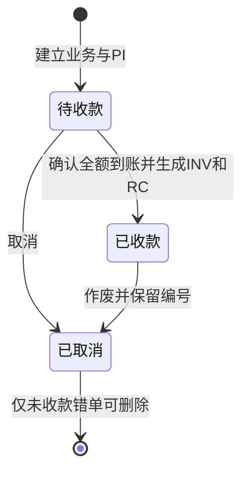

# 业务规则与当前边界

| 决策 | 当前实现 | 原因或限制 |
| --- | --- | --- |
| 业务作为操作入口 | 客户、服务、金额与单据关联 | 减少在多个编号间寻找入口 |
| 金额用最小货币单位存储 | 123450 表示 1234.50 | 避免直接用小数反复计算金额；仍需限制有效范围 |
| HKD 与 USD 分开汇总 | 每币种各列待收和已收 | 未实现汇率换算，不应直接相加 |
| 全额收款后开 INV / RC | 手动确认银行到账日期 | 没有银行接口；部分付款流程尚未实现 |
| 年度单据序号 | PI、INV、RC 分别编号 | 当前单本地账本范围内检查，不能保证多人并行生成不冲突 |
| 取消与删除有区别 | 取消保留；未收款、未生成 INV / RC 的取消 PI 可删除 | 仅适合处理尚未发送的错单；删除会释放同年 PI 序号 |
| 已收款记录取消 | 保留 INV / RC，单据显示取消 | 不执行退款，也没有贷项通知单流程 |
| 合并导入 | 相同跳过，同号金额或状态冲突时拒绝 | 不自动裁决两份不同账本谁正确 |
| OCR 先核对再保存 | 名称、登记号码与地址待确认 | 版式与清晰度会影响识别 |
| 公司设置迁移 | 完整备份包含设置，导入时明确选择是否恢复 | 旧备份兼容；避免无意覆盖当前公司资料 |
| 演示隔离 | 演示使用独立本地存储键 | 体验和重置均限于虚构账本 |
| 本地保存 | localStorage，无后台 | 可独立运行，跨设备迁移需要手动备份 |

这是服务业务单人使用的轻量工具。当前不包含多行商品、税项、部分收款、团队权限及不可篡改审计日志。复用时应按自己的业务要求调整模板、编号和保留规则。

公开版本使用新的存储键，从空账本启动，避免与原有私人版本混用。演示公司配置和客户记录均为虚构。

## 核心状态

取消和退款分别处理；删除不会执行银行操作。导入恢复已有记录也不会自动确认到账。
